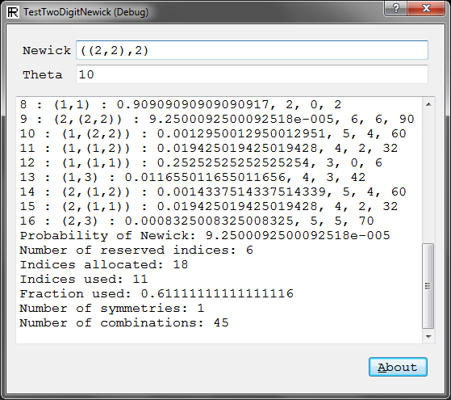

# TwoDigitNewick

Implementation of a frequency Newick.

TwoDigitNewick is one of [Richèl Bilderbeek's tools](https://richelbilderbeek.github.io/tools/).

## Links

- [Source code](https://github.com/richelbilderbeek/TwoDigitNewick)
- [Richèl Bilderbeek's tools](https://richelbilderbeek.github.io/tools/)
